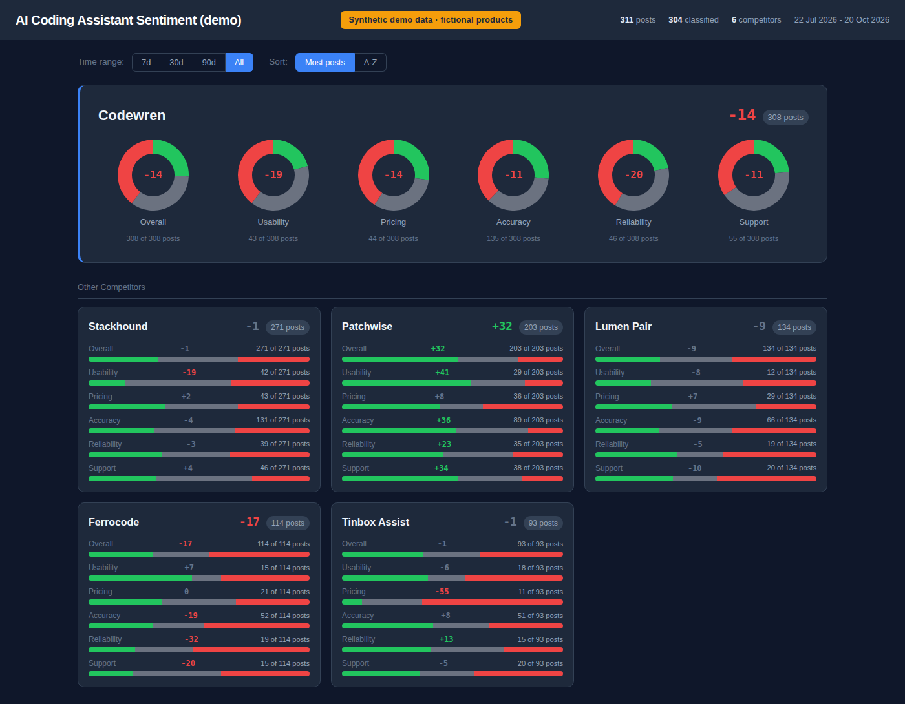
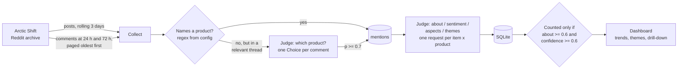
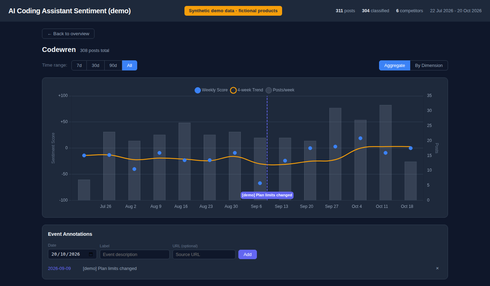

# Reddit product sentiment

A daily pipeline that reads product subreddits, finds every post and comment about a set of products, and has a typed-judgment model answer a fixed set of questions about each one: is this really about the product, how does the author feel about it, and what are they talking about. A small dashboard turns the results into trends and lets you click through to the comments behind any number.

I originally built this for my work as a product manager on a legal-AI product. The example configuration here tracks AI coding assistants instead, so the repo can be public; everything product-specific lives in one file, [`config.yaml`](config.yaml).



*Synthetic demo data. The products (Codewren, Stackhound and so on) are invented, and every thread, comment and score is generated. Nothing here is a finding about a real tool.*

## The problem

Product teams already have surveys, NPS and support tickets. What they rarely have is a steady read on what practitioners say to each other when the vendor isn't in the room. Reddit is one of the few places that happens in public, but reading it by hand doesn't scale and doesn't give you a trend.

The obvious fix is to point an LLM at the posts and ask for a sentiment score. My first version did exactly that, and the numbers looked plausible but couldn't be trusted (see [Key decisions](#key-decisions-and-the-evidence-behind-them)). The real problem turned out to be **consistency**: if the same comment can get a different score next week, a trend line tells you nothing.

## Who it's for

- **A PM or product marketer** who wants to know whether sentiment about their product, and about each competitor, is moving, and why.
- **Anyone running a launch or pricing change** who wants to see the reaction land, with event annotations on the trend chart.
- **Researchers** who want the comments, not a summary: every score links to the text it came from.

## Approach

**A deterministic pipeline with one small, typed model call per item. No agent loop.**

Code fixes the whole sequence. The model never decides what happens next; it only answers fixed questions about one comment and one product at a time, and returns typed values (a probability, a graded score with a confidence, a choice from a list) rather than prose.



What each judgment asks, for one (comment, product) pair:

| Question | Type | Used for |
|---|---|---|
| `about` | probability | Is this an opinion about, or experience with, *this* product? Passing mentions, job ads and "mouse cursor" fail here. |
| `sentiment` | 0–4 score + confidence | Five levels, each described as a concrete situation, from "warns others off it" to "recommends it". |
| `aspect_*` (5) | probability each | Usability, pricing, accuracy, reliability, support. Multi-label. |
| `theme_*` (9) | probability each | A fixed list of finer topics (hallucinated APIs, pricing and limits, context on large codebases…). Multi-label. |

The comment's own words go in `text`; the thread title, original post and the comment it replies to go in a separate `context`. Keeping them apart stops a parent comment's topics being labelled onto the reply.

### Two judge backends, one interface

| Backend | When to use it | Key |
|---|---|---|
| **TypeSafe Jev** (default) | The design target. A typed-judgment model: each question is answered independently and its probabilities are calibrated, which is what made the numbers stable. | `TYPESAFE_API_KEY` |
| **Claude** (`claude-haiku-5-5` by default) | So anyone can run it. One structured-output call per item against a JSON schema built from the same config, same output shape. | `ANTHROPIC_API_KEY` |

Pick with `JUDGE_BACKEND=jev|claude`. Both are in [`sentiment/backends/`](sentiment/backends/). The thresholds were tuned against Jev's calibrated probabilities; Claude's are self-reported, so re-check the thresholds on a hand-labelled sample before comparing numbers across backends.

## Key decisions and the evidence behind them

**1. Judge one item at a time, with typed answers, not one big generation.**
Version one asked a general model to score batches of 10 texts × 15 products × 5 dimensions in a single JSON response. I re-ran 100 of its archived scores through a typed-judgment model:

- It judged **42 of the 100** not actually about the product at all: job adverts, unrelated threads that happened to share a word with a product name. I hand-checked the 10 clearest cases and it was right on all 10. Version one had scored them "neutral", which padded the data and flattened every trend.
- On the texts that were on-topic, the two agreed **49 of 58** times.
- Version one disagreed with *itself*: two runs agreed on only **77%** of the same posts. The typed model gave the same answer on **18 of 20** repeat requests.
- Its one clear miss read a sceptical comment as praise, at confidence 0.67. The confidence gate exists to drop exactly that kind of case.

**2. Gate what counts, but keep everything.**
Every mention is stored with its probabilities. Only mentions with `about ≥ 0.6` and sentiment confidence `≥ 0.6` are counted. The gates are applied when reading, not when writing, so tuning them changes history retroactively with no re-judging, and the pipeline and dashboard read them from the same config.

**3. Find mentions that don't use the product's name.**
Plenty of useful comments say "it hallucinated twice on me" in reply to a comment naming a product. Every comment in a relevant thread is stored, and comments that name nothing get one "which product?" question with the thread as context. Tested on 800 such comments before switching it on: 34 were assigned a product, 6 of those passed the on-topic gate, and about 5 of the 6 were right. The wrong picks were mostly jokes, which the `about` question scored between 0.03 and 0.24, so they never counted. Net effect: roughly **15–20% more counted mentions**. Re-judging 150 existing mentions with the new context format agreed with the old judgment on on-topic **142/150** times and on sentiment bucket **45/46** times.

**4. A fixed theme list, on purpose.**
The model classifies against a list; it doesn't summarise or invent topics. That makes weeks comparable, and makes "pricing complaints doubled" a statement you can check.

**5. Read whole threads, in two passes.**
Arctic Shift returns comments newest first. The original single fetch took the newest 50, which silently dropped the early discussion on busy threads and never saw late replies. Now each thread is read at 24 h and again at 72 h, paging forward from a cursor, oldest first. Two gotchas found in live testing are pinned by tests: Arctic Shift returns a 400 for `after=0`, so the cursor starts at the post's own time; and the client used to return `[]` on error, which marked threads "fully read" with nothing read. It now returns `None` and the thread stays queued.

**6. Failures retry tomorrow; loops can't spin.**
Judging runs in batches. A failed request leaves its row unjudged for the next run, and each batch loop stops on any failure, so an outage can't cause the same rows to be re-asked forever. A run only exits non-zero if nothing at all could be judged.

## Cost per run

A typical day in the original domain: about 1,000 "which product?" checks (~925 input tokens each) and about 50 full judgments (~1,500 input tokens each).

| Backend | Pricing | Daily cost |
|---|---|---|
| TypeSafe Jev | Input tokens only, about $0.04 per million | **≈ $0.04/day**, measured |
| Claude Haiku 5.5 | $0.10 / $0.50 per million input / output tokens | **≈ $0.10–0.20/day**, estimated |

The Claude figure is an estimate, not a measurement: roughly 800 input and 100 output tokens per "which product?" check, and 1,500 input and 450 output tokens per judgment (the JSON plus some thinking at low effort). Output tokens are most of the difference. Run it for a week and read the token counts the pipeline logs before trusting either number. Either way it is a few dollars a month; the Batch API would roughly halve the Claude figure, since nothing here is latency-sensitive.

## Limitations

- **Reddit skews negative.** In the original domain every product scored below zero overall, partly because people post to complain, and partly because the `about` question requires an opinion, so neutral mentions mostly drop out. Compare products and trends; don't read absolute levels.
- **Volume is small.** A product with a handful of counted mentions a week is noise. Scores are hidden below `min_n` (3) mentions, and that bar is low.
- **Arctic Shift is a community archive**, not an official API. Coverage and latency can vary.
- **Comments posted after the second pass (72 h) are not collected.**
- **Calibration is backend-specific.** Thresholds tuned for one judge model don't automatically transfer to another, or to a new version of the same one; the Jev model is pinned for that reason.
- **The theme list is only as good as its wording.** In the original domain, the workflow theme fired more often than it should have.

## What I'd do next

- **A small labelled evaluation set** (a few hundred comments) checked into the repo, so a model or prompt change is a measured decision, and so the two backends can be compared properly.
- **Measured Claude costs** from real runs, and the Batch API for the daily job.
- **A weekly digest** of the biggest movers, with the two or three comments that explain each move. Rendered in code from the numbers, so no figure passes through a model.
- **Confidence intervals on the weekly scores**, so small samples look as uncertain as they are.
- **More sources** (Hacker News, product forums) behind the same judgment step.

## Quickstart

Requirements: Python 3.10+, Node 20+.

### Demo, no API keys

```bash
make install    # venv + Python deps + dashboard deps
make demo       # ~90 days of synthetic data about fictional products, in ./data
make dashboard  # http://127.0.0.1:3852
```

The demo uses [`config.demo.yaml`](config.demo.yaml), which swaps in six invented products and inherits everything else from `config.yaml`. The database is flagged as demo data, so the dashboard shows a "Synthetic demo data" banner, and a real run refuses to write into it. Use a fresh `DATA_DIR` (or delete `data/sentiment.db`) before collecting real data.



*Trend view for a fictional product, with a made-up event annotation lined up against a dip.*

### Real data

```bash
cp .env.example .env     # set JUDGE_BACKEND and the matching API key
make run                 # collect, infer, judge (first run: a few minutes)
make dashboard
```

Schedule `make run` (or `python -m sentiment run`) once a day with cron or similar. `python -m sentiment run --backfill-days 30` widens the window once.

### Docker

```bash
make docker-demo                 # synthetic data + dashboard
cp .env.example .env && docker compose up -d    # daily pipeline + dashboard
```

The dashboard binds to `127.0.0.1` by default (`HOST`, `PORT` to change). It has no authentication, so put it behind something that does before exposing it.

### Pointing it at your own market

Edit [`config.yaml`](config.yaml): products and aliases, subreddits, the relevance regex, aspects, themes and thresholds. Nothing else in the code names a product. Theme and aspect keys must be `lower_snake_case`.

### Tests

```bash
make test       # pytest (collection, inference, judging, config, both backends with mocked HTTP) + dashboard
```

## Layout

```
config.yaml               the one place products, labels and thresholds live
config.demo.yaml          demo overlay: fictional products only
sentiment/
  collect.py              Arctic Shift posts + two-pass paged comments
  judge.py                "which product?" and the per-mention judgment stages
  backends/               JudgeBackend interface, Jev and Claude implementations
  demo.py                 synthetic data generator (fictional products, flagged as demo)
  store.py                SQLite schema
dashboard/                Express + better-sqlite3 API, single-page UI (Chart.js)
tests/                    pytest suite
```

## Licence

MIT. Reddit content belongs to its authors; respect Reddit's and Arctic Shift's terms if you collect real data.
